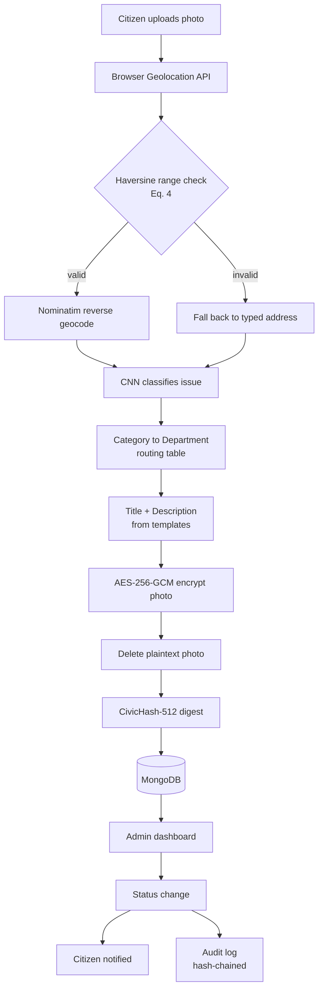

# CivicAI — Civic Issue Reporting and Resolution System

> Citizens photograph a civic problem. An on-device CNN identifies it, routes it
> to the right municipal department, and files it with GPS location — protected
> end-to-end by six independent cryptographic layers.

---

## Table of Contents

- [Overview](#overview)
- [How a Complaint Flows Through the System](#how-a-complaint-flows-through-the-system)
- [The Issue Classifier](#the-issue-classifier)
- [Geolocation (Module 5)](#geolocation-module-5)
- [Security Architecture](#security-architecture)
- [Project Structure](#project-structure)
- [Setup & Installation](#setup--installation)
- [Training the Model](#training-the-model)
- [Running the Application](#running-the-application)
- [Demos & Diagnostics](#demos--diagnostics)
- [Tech Stack](#tech-stack)

---

## Overview

CivicAI lets citizens report local infrastructure problems — potholes, garbage,
broken streetlights, waterlogging — by uploading a photograph. The system:

1. **Classifies** the issue with a locally trained convolutional network
2. **Routes** it to the responsible municipal department
3. **Locates** it via browser GPS and OpenStreetMap reverse geocoding
4. **Encrypts** the evidence photograph with AES-256-GCM
5. **Seals** the record with a CivicHash-512 integrity digest
6. **Tracks** it through pending → in progress → resolved, notifying the citizen
   at every status change

There is **no external AI API**. Classification runs on this machine, so the
system needs no API key, costs nothing per complaint, works offline, and never
sends a citizen's photograph to a third party.

---

## How a Complaint Flows Through the System



---

## The Issue Classifier

### What replaced the API

Earlier versions sent every photograph to a hosted multimodal LLM, which parsed
free text back into four fields. That approach cost an API call per complaint,
required a key, and broke without connectivity.

It is now a **fine-tuned ResNet18**:

| Stage | Mechanism |
|---|---|
| Category | ResNet18 CNN, ImageNet-pretrained, fine-tuned on civic photographs |
| Department | Deterministic lookup table (`training/config.py` → `DEPARTMENT_MAP`) |
| Title | Category template, with the reverse-geocoded place appended |
| Description | Category template stating hygiene / safety / environment impact |

### Why templates for the prose

Deterministic text matters here for a cryptographic reason: the title and
description are **bound into the CivicHash-512 digest**. A generative model
producing different wording each run would make a record's own digest
irreproducible, so integrity verification could never distinguish regenerated
text from tampering.

### Confidence handling

Predictions below `LOW_CONFIDENCE_THRESHOLD` (0.55) are still filed, but flagged
in the description and shown to the citizen with a warning. A wrong department
is worse than an acknowledged uncertainty.

---

## Geolocation (Module 5)

| Step | Implementation |
|---|---|
| Capture | Browser Geolocation API via JavaScript in the Gradio client |
| Validation | Haversine great-circle distance from the municipal centroid (Eq. 4) |
| Resolution | OpenStreetMap Nominatim reverse geocoding → address, ward, city |
| Fallback | Citizen types an address; stored and clearly marked *not GPS-verified* |

Coordinates are bound into the integrity digest, so a complaint's reported
location cannot be silently moved in the database.

Nominatim requires an identifying User-Agent and permits one request per second;
both are enforced in `app/geo_service.py`, and results are cached in-process.

Configure the municipality in `.env` — see [.env.example](.env.example).

---

## Security Architecture

```
┌─────────────────────────────────────────────────────────────┐
│                      SECURITY STACK                         │
├─────────────────────────────────────────────────────────────┤
│  Layer 1 │ bcrypt password hashing (cost factor 12)         │
│  Layer 2 │ ECDSA P-256 admin digital signatures             │
│  Layer 3 │ Signature-derived one-time password (2FA)        │
│  Layer 4 │ AES-256-GCM image encryption at rest             │
│  Layer 5 │ CivicHash-512 record integrity digest            │
│  Layer 6 │ HMAC-SHA256 JWT session tokens                   │
│  Plus    │ Hash-chained tamper-evident audit log (Eq. 21)   │
└─────────────────────────────────────────────────────────────┘
```

### CivicHash-512

A 512-bit digest chaining three primitives, requiring **three independent
secrets** to reproduce:

```
Step 1  Normalise    → canonical, key-sorted JSON bytes
Step 2  AES-256-GCM  → ciphertext + 16-byte auth tag   (secret: keys/aes_image_key.bin)
Step 3  HMAC-SHA256  → 32-byte digest                  (secret: pepper constant)
Step 4  SHA-512 × 3  → 512-bit final hash              (secret: per-record salt)
```

Covered fields: title, category, department, description, user_id, timestamp,
status, **latitude, longitude, address**.

> **Hash versioning.** Records store a `hash_version`. Version 1 covered text
> fields only; version 2 adds location. Verification honours each record's own
> version, so complaints filed before location capture existed still verify
> rather than being falsely reported as tampered.

### Hash-chained audit log

Each entry is bound to its predecessor:

```
h_i = SHA-256( h_{i-1} || event_i || timestamp_i || details_i )
```

Deleting, reordering or editing any historical entry invalidates every hash
after it. Verify at any time with `python -m app.security_audit`.

### Plaintext scrubbing

After encryption is confirmed, the plaintext image is deleted immediately. Only
the `.enc` file persists.

---

## Project Structure

```
AI_CIVIC_ISSUE_REPORTER/
│
├── app/
│   ├── gradio_app.py         ← Web interface, routing, dashboards
│   ├── ai_service.py         ← Photo → title/category/department/description
│   ├── civic_classifier.py   ← CNN inference (loads the trained checkpoint)
│   ├── issue_text.py         ← Title & description templates per category
│   ├── geo_service.py        ← Haversine validation + Nominatim geocoding
│   ├── auth.py               ← Registration & login wrappers
│   ├── db_utils.py           ← MongoDB access, integrity binding
│   ├── admin_signature.py    ← ECDSA P-256 keypairs & challenge signing
│   ├── complaint_hash.py     ← CivicHash-512
│   ├── image_encryption.py   ← AES-256-GCM encrypt/decrypt
│   ├── jwt_tokens.py         ← Pure-Python HMAC-SHA256 JWT
│   ├── password_utils.py     ← Password hashing helpers
│   ├── security_audit.py     ← Hash-chained audit log
│   ├── image_processor.py    ← Image resize/encode helpers
│   └── init_db.py            ← MongoDB connection check
│
├── training/
│   ├── config.py             ← Paths, hyperparameters, department routing
│   ├── download_civic.py     ← Kaggle download + structure report
│   ├── prepare_civic.py      ← Class discovery + 70/15/15 split manifest
│   ├── data.py               ← Datasets, augmentation, loaders
│   ├── model.py              ← ResNet architecture + device selection
│   ├── train_civic.py        ← Fine-tuning loop
│   └── evaluate_civic.py     ← Metrics, figures and LaTeX tables
│
├── keys/                     ← AES key + ECDSA keypairs   (gitignored)
├── data/                     ← Dataset + split manifest    (gitignored)
├── models/                   ← Trained checkpoint          (gitignored)
├── figures/                  ← Generated PNGs for the paper
├── reports/                  ← metrics.json, results_tables.tex
├── logs/security.log         ← Hash-chained audit trail
├── uploads/                  ← Encrypted evidence (.enc only)
├── .env                      ← Configuration               (gitignored)
└── requirements.txt
```

> **Never commit** `keys/`, `.env`, or any `.bin`/`.pem` file.

---

## Setup & Installation

### Step 1 — Virtual environment

```bash
python -m venv venv
venv\Scripts\activate          # Windows
source venv/bin/activate       # macOS / Linux
```

### Step 2 — Dependencies

```bash
pip install -r requirements.txt
```

> Installs the CUDA build of PyTorch. On a machine without an NVIDIA GPU, remove
> the `--extra-index-url` line from `requirements.txt` first to get CPU wheels.

### Step 3 — Configuration

```bash
copy .env.example .env         # Windows
cp .env.example .env           # macOS / Linux
```

Then generate a JWT secret and paste it into `.env`:

```bash
python -c "import secrets; print(secrets.token_hex(32))"
```

### Step 4 — Start MongoDB

The app expects MongoDB at `mongodb://localhost:27017/`. Verify with:

```bash
python -m app.init_db
```

---

## Training the Model

Complaint submission will not work until a classifier exists.

### Step 1 — Kaggle credentials

Go to <https://www.kaggle.com/settings> → **API** → **Create New Token**, then
move the downloaded `kaggle.json` to:

```
C:\Users\<you>\.kaggle\kaggle.json          # Windows
~/.kaggle/kaggle.json                        # macOS / Linux
```

### Step 2 — Download, prepare, train, evaluate

```bash
python -m training.download_civic     # fetch the dataset, print its structure
python -m training.prepare_civic      # discover classes, build the split manifest
python -m training.train_civic        # fine-tune the ensemble (~1-2 h on an MX450)
python -m training.evaluate_civic     # metrics, figures, LaTeX tables
```

`train_civic` fine-tunes each backbone in `ENSEMBLE_ARCHS` (ResNet-50 and
EfficientNet-B0 by default) and writes one checkpoint per member plus a bundle
at `models/civic_classifier.pt` that lists them. Inference averages the
members' predictions, each scored on the image and its mirror.

Useful flags:

```bash
python -m training.train_civic --arch resnet50     # one backbone only
python -m training.train_civic --epochs 15         # shorter run
python -m training.train_civic --batch-size 8      # start smaller on a tight GPU
```

The first run decodes every photograph once into
`data/civic_split/cache_*_280.npy` (~320 MB). Decoding the source JPEGs costs
123 ms each — six times the augmentation that follows — so caching them cuts
epoch time by roughly a factor of five. The cache is derived data: delete it
and it rebuilds.

On a 2 GB card the run halves its batch size and doubles gradient accumulation
whenever a backbone runs out of VRAM, so the effective batch — and therefore
the schedule — stays the same.

### If the GPU keeps resetting

Some laptop GPUs (the MX450 among them) trip the Windows display driver's
timeout watchdog under sustained load. The driver resets the card, the CUDA
context dies, and every later call fails with `CUDA error: unknown error`. No
process can recover from that — but `train_civic` parks its full training state
after each epoch, so a restart costs one epoch rather than the whole run:

```bash
python -m training.run_training --epochs 30   # same flags as train_civic
```

`run_training` relaunches the trainer after a driver reset and stops if the
failure is anything else (a bad flag, a missing dataset). Add `--fresh` to
discard parked state and start over.

`evaluate_civic` writes publication-ready output:

| File | Contents |
|---|---|
| `figures/class_distribution.png` | Test-set composition |
| `figures/per_class_metrics.png` | Precision / recall / F1 per category |
| `figures/confusion_matrix.png` | Row-normalised confusion matrix |
| `figures/roc_curves.png` | One-vs-rest ROC with AUC |
| `figures/confidence_distribution.png` | Confidence, correct vs incorrect |
| `figures/training_curves.png` | Loss and accuracy per epoch |
| `reports/metrics.json` | Every number, machine-readable |
| `reports/results_tables.tex` | LaTeX for the results tables |

---

## Running the Application

```bash
python -m app.gradio_app
.\venv\Scripts\python.exe -c "import secrets; print('JWT_SECRET=' + secrets.token_hex(32))"

```

The interface starts at <http://localhost:7860>. Startup prints the state of
each subsystem — AES key, classifier, audit chain, geolocation.

### Accounts

Register through the interface. Admin registration is restricted to the
whitelist in `gradio_app.py` (`ALLOWED_ADMIN_EMAILS`).

Admin sign-in is three-factor:

1. bcrypt password verification
2. One-time password (printed to the terminal, derived from an ECDSA signature)
3. ECDSA P-256 signature verification against the stored public key

---

## Demos & Diagnostics

```bash
python -m app.security_audit        # verify the audit hash chain
python -m app.complaint_hash        # CivicHash-512 walkthrough + tamper test
python -m app.image_encryption      # AES-256-GCM encrypt/decrypt demo
python -m app.admin_signature       # ECDSA P-256 signing + tamper test
python -m app.jwt_tokens            # JWT issue, verify, and forgery test
python -m app.password_utils        # bcrypt hashing demo
```

Inspect the AES key in hex:

```bash
python -c "print(open('keys/aes_image_key.bin','rb').read().hex())"
```

---

## Tech Stack

| Component | Technology |
|---|---|
| Web interface | Gradio |
| Issue classifier | PyTorch, ResNet18 (ImageNet-pretrained, fine-tuned) |
| Geolocation | Browser Geolocation API + OpenStreetMap Nominatim |
| Encryption | AES-256-GCM (`cryptography`, OpenSSL backend) |
| Digital signatures | ECDSA P-256 (secp256r1) |
| Password hashing | bcrypt, cost factor 12 |
| Session tokens | Pure-Python HMAC-SHA256 JWT (no third-party JWT library) |
| Database | MongoDB via PyMongo |
| Language | Python 3.11+ |

---

## Security Checklist

- [x] Photographs encrypted at rest with AES-256-GCM
- [x] Plaintext photographs deleted immediately after encryption
- [x] Passwords hashed with bcrypt, never stored in plaintext
- [x] Admin access requires password + OTP + ECDSA signature
- [x] Complaint records sealed with CivicHash-512, location included
- [x] Audit log hash-chained and independently verifiable
- [x] Session authorisation enforced from signed JWTs, not client state
- [x] Keys, `.env` and datasets excluded from version control
- [x] No citizen photograph is transmitted to any third party

---

*Developed for CNS BCSE309P — Cryptography and Network Security, VIT Chennai.*
'''
{
  "permissions": {
    "allow": [
      "Bash(./venv/Scripts/python.exe -m pip list)"
    ]
  }
}
'''